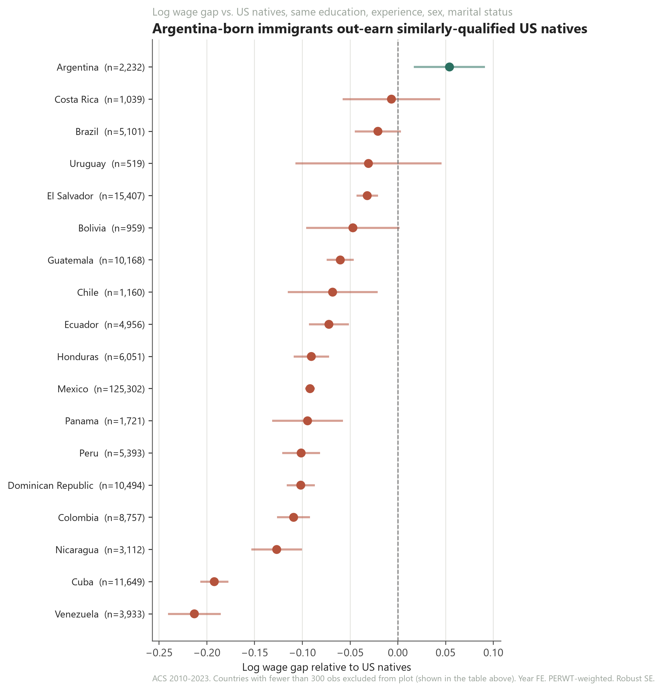
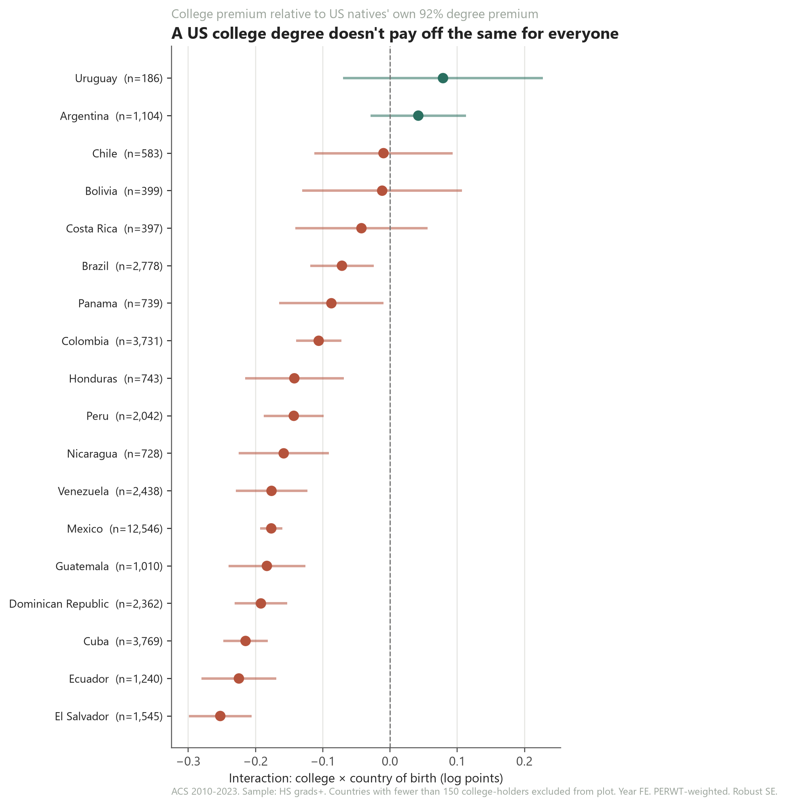
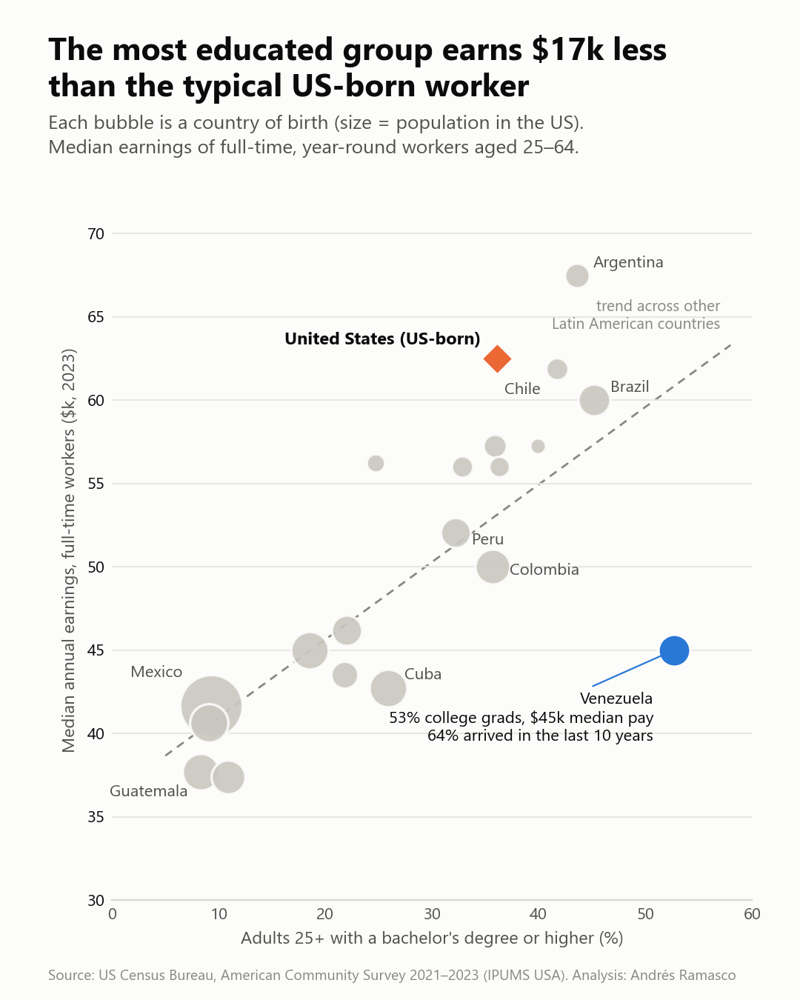

# Latin American Immigrant Wages in the US (ACS 2010–2023)

Among Latin American immigrants in the US, how do wages differ by country of birth relative to observationally equivalent US natives? Does a college degree pay off the same regardless of where you were born?

The analysis uses 14 years of American Community Survey microdata (IPUMS USA, ~15M person-year observations). It has two parts: a Stata pipeline, and a Python notebook that replicates and extends it.



## Key findings

- **Wage gaps vary widely by origin.** Controlling for schooling, experience, sex, marital status, English proficiency and year fixed effects, **Argentina-born** workers earn about **6% more** than comparable US natives. **Venezuela-born** workers earn about **19% less**, the widest gap in the sample. Mexico, the largest group, sits at about −9%.
- **The same US degree pays off differently.** For US natives, a bachelor's degree carries a **92%** premium over a high-school diploma. The premium is about **49%** for El Salvador-born workers and about **108%** for Uruguay-born workers, although Uruguay's estimate is imprecise (n = 186).



## Who are they? Education and pay by country of birth

A companion profile pools ACS 2021–2023 and describes every Latin American-born group in the US against a US-born benchmark (2% sample).

- **Venezuelans are the most educated group.** 53% of Venezuela-born adults 25+ hold a bachelor's degree or more, compared with 36% of the US-born and 9% of the Mexico-born.
- **They earn far less than that education predicts.** Their median full-time, year-round earnings are about $45k, roughly $17k below the typical US-born worker and well under the trend across other Latin American countries.
- **Recent arrival is a likely reason.** 64% of Venezuela-born residents arrived in the last 10 years, the highest share of any group.



The full table (population, age, English proficiency, naturalization, years in the US, employment, earnings and top state for each country) is in [`results/tables/population_profile.csv`](results/tables/population_profile.csv).

## Method

Pooled Mincer regression, PERWT-weighted, heteroskedasticity-robust (HC1) SEs:

```
ln(hourly wage) = β·yrs_educ + exp + exp² + degree dummies (sheepskin)
                + country-of-birth FE (ref: US natives)
                + female + married + english_well + year FE
```

The college-premium specification interacts `college × country of birth`, on the high-school-and-above sample.

## Data-quality fixes found along the way

The notebook documents three bugs in the original Stata prep and fixes them:

1. **Nine years silently dropped.** ACS asks for an exact count of weeks worked (`WKSWORK1`) only since 2019. Dropping rows with missing `WKSWORK1` discarded all of 2010–2018. The notebook imputes the midpoint of the bracketed `WKSWORK2` (flagged in `wkswork1_imputed`), which recovers **15.1M observations instead of 5.0M**.
2. **Anglophone Caribbean exclusions never matched.** The code compared against names like `"saint lucia"`, but IPUMS uses `"St. Lucia"`.
3. **Leftover "not specified" (`, ns`) categories** had to be dropped.

## Repository layout

| Path | Contents |
|---|---|
| `do/master.do` | Runs the Stata pipeline: `1_data_prep.do` → `2_mincer_by_country.do` → `3_college_premium.do` (uses `reghdfe`) |
| `do/ipums_extract_spec.md` | Exact IPUMS samples and variables needed to rebuild the extract |
| [`notebooks/latam_wages_exploration.ipynb`](notebooks/latam_wages_exploration.ipynb) | Python translation plus the fixes above, the charts, and a gender-gap extension |
| `notebooks/extract_population.py` | Reads the raw extract in chunks and keeps Latin American-born residents plus a 2% US-born sample (ACS 2021–2023) |
| `notebooks/population_profile.py` | Builds the country-of-birth profile table |
| `notebooks/population_plots.py` | Draws the education and pay figures from the profile table |
| `results/figures/` | Figures |

## Data

The microdata **is not included**. IPUMS terms of use do not allow redistribution, and the extract is about 3.6 GB. To reproduce:

1. Request the extract described in [`do/ipums_extract_spec.md`](do/ipums_extract_spec.md) from [IPUMS USA](https://usa.ipums.org/usa/). A free account is required.
2. Save it as `data/acs_2010_2023_raw.dta`.
3. For Stata, run `do do/master.do` from the repo root. For Python, `pip install -r requirements.txt` and run the notebook from `notebooks/`.

The regressions use a 3M-row random subsample by default (`REGRESSION_SAMPLE_N`), because `statsmodels` builds a dense design matrix.

*Data: Ruggles et al., IPUMS USA, University of Minnesota, [ipums.org](https://www.ipums.org). See IPUMS for the current citation format.*

## License

The code is released under the [MIT License](LICENSE). The figures and tables in `results/` are released under [CC BY 4.0](https://creativecommons.org/licenses/by/4.0/). The ACS microdata remain subject to the IPUMS terms of use.

## Citation

If you use this code or its figures, please cite the repository. GitHub's "Cite this repository" button uses `CITATION.cff`.
